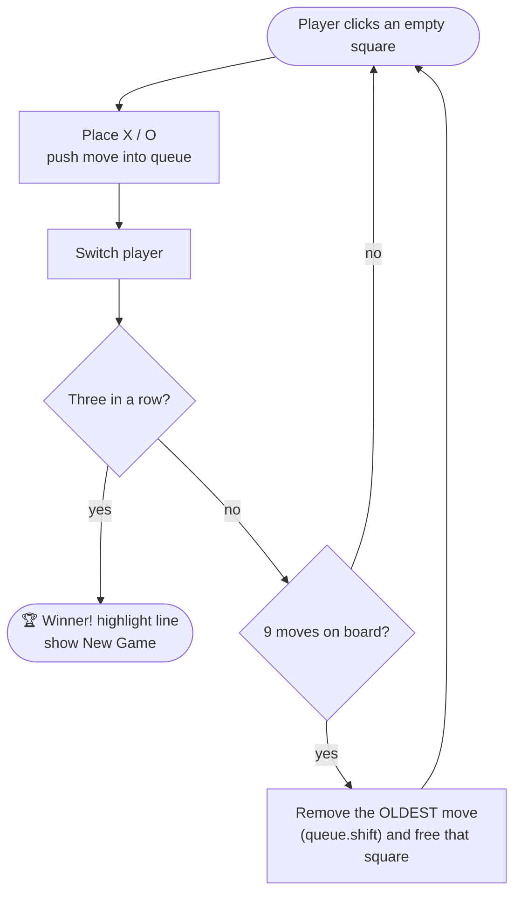

<div align="center">

# ♾️ Recursive Tic-Tac-Toe

**Tic-Tac-Toe with a twist — the board never fills up. Once all nine squares are taken, the oldest move vanishes, so there are no draws: someone *has* to win.**

[](https://recursive-tic-tac-toe.vercel.app)


[The Twist](#-the-twist) · [Rules](#-rules) · [Getting Started](#-getting-started) · [How it's built](#%EF%B8%8F-how-its-built)

</div>

---

## 🔁 The Twist

Classic Tic-Tac-Toe ends in a draw far too often. Here, every move is remembered in a **queue** — when the board is full and nobody has won, the **oldest mark is erased** and play continues. You have to think about which of your marks is about to disappear!



## 📜 Rules

1. **X** always starts; players alternate turns.
2. Get **three in a row** — horizontally, vertically or diagonally — to win.
3. When all **9** squares are filled and there's no winner, the **earliest** mark on the board disappears.
4. There are **no ties** — the game continues until someone wins.

<details>
<summary><b>🎯 Example</b></summary>

<br/>

```text
Board full, no winner          Oldest move (X at top-left) vanishes
 X | O | X                       _ | O | X
---+---+---                     ---+---+---
 X | O | O        ─────────▶      X | O | O
---+---+---                     ---+---+---
 O | X | X                       O | X | X
```

Now the next player can take that freed square.

</details>

## 🚀 Getting Started

No installs, no build step:

```bash
git clone https://github.com/Shariq2003/Recursive-Tic-Tac-Toe.git
cd Recursive-Tic-Tac-Toe
# open index.html in your browser
```

## 🛠️ How it's built

| Piece | Implementation |
|---|---|
| Board state | `gameGrid` — array of 9 cells |
| Move history | `moves` — a FIFO queue of cell indexes |
| Win check | 8 winning lines checked after every move |
| Recycling | `moves.shift()` clears the oldest cell when 9 moves are on the board |
| UI | Vanilla DOM, CSS grid, winning cells highlighted |

<details>
<summary><b>📁 Project structure</b></summary>

```text
Recursive-Tic-Tac-Toe/
├── index.html
├── styles.css
└── index.js
```

</details>

---

<div align="center">

Built by **[Shariq](https://github.com/Shariq2003)** · [LinkedIn](https://www.linkedin.com/in/shariq-sd)

⭐ If this twist made you think, consider giving it a star!

</div>
